Title: Unlayered

Author: Maxim Fazzari

Description: A non-planer printer that utilizes a corexy enclosed design and and long sharp nozzle to print diagonal layers instead of only flat.

Created_at: "2026-10-09"

# October 9: Created the skeleton #

Spent 10 minutes today working on the skeleton didn't have much other time to do anything else. Still think about how I am going to make the connectors thinking about a piece per corner, Most likely ABS filemnt then using screws and nut to clamps the nuts onto eaxh 2020 extrusion.

**Total time spent: 10 min**

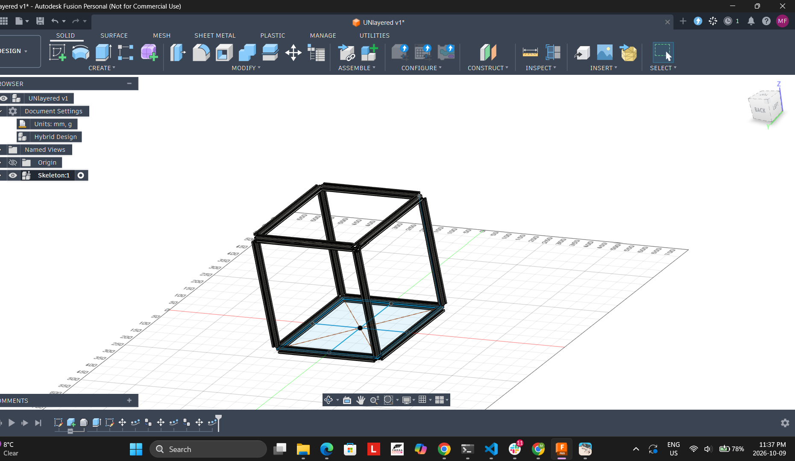

# October 10: Created the skeleton connectors #

Spent 2 hours today working on the connectors to connect the 2020 extrusions to each other. I used m3.5 screws and a nut under the rail to clamp the connector to each extrsuion. Had some major setback with desin issues like not being able to combine some of the different bodies but I got it all settled in the end. Accidently also forgot to lapse part of it so there might be a weird moment missing, uhh now wondering about the pulleys, thinking about how big they should be prob like 20mm is fine, Right, Yahhhhh!!!

**Total time spent: 2 hours**

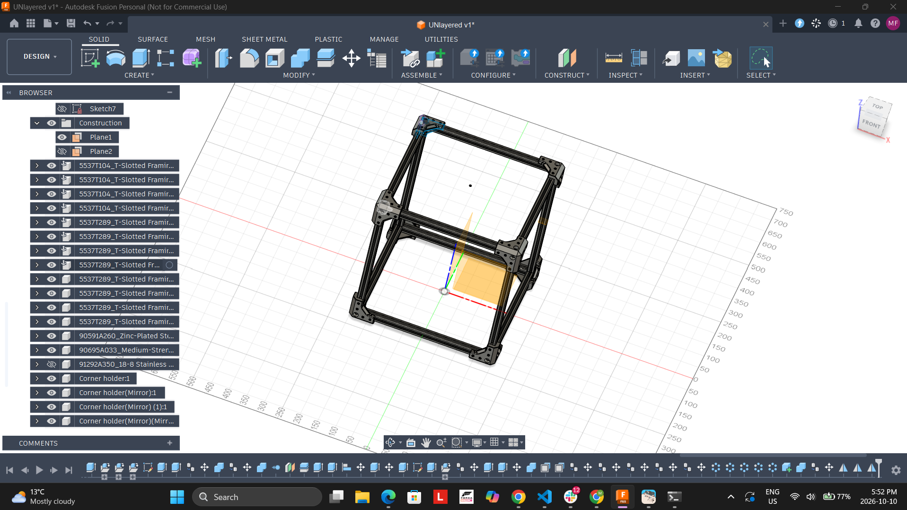

# October 11 to 12: Created the idle pullet mount and adjustable rod guide#

Spent 4 hours today working on the idle pulley mounts and guide rod mount. First tried to connect the whol mount to it's own mount but the Skeleton connector got in the way, so I decided to connect it directly to the skeletion mount. The guide rod is secrued with 4 Hex screws and is adjust able so the tighter the screws the more stable the mount is. Each of the pulleys have there own bearings inside them so no extra bearings needed. They are inserted then placed on with 2X m3.5 metric low porfile screws on oppsite ends.

**Total time spent: 4 hours**
 Both connectors and the rod 
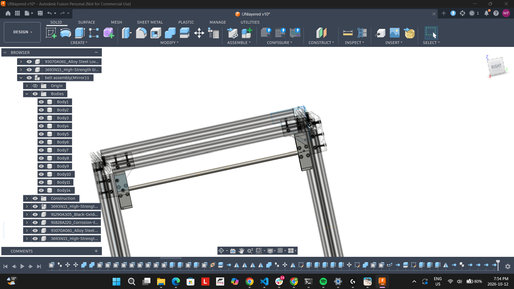

 Section of the Pulley inside the mount 
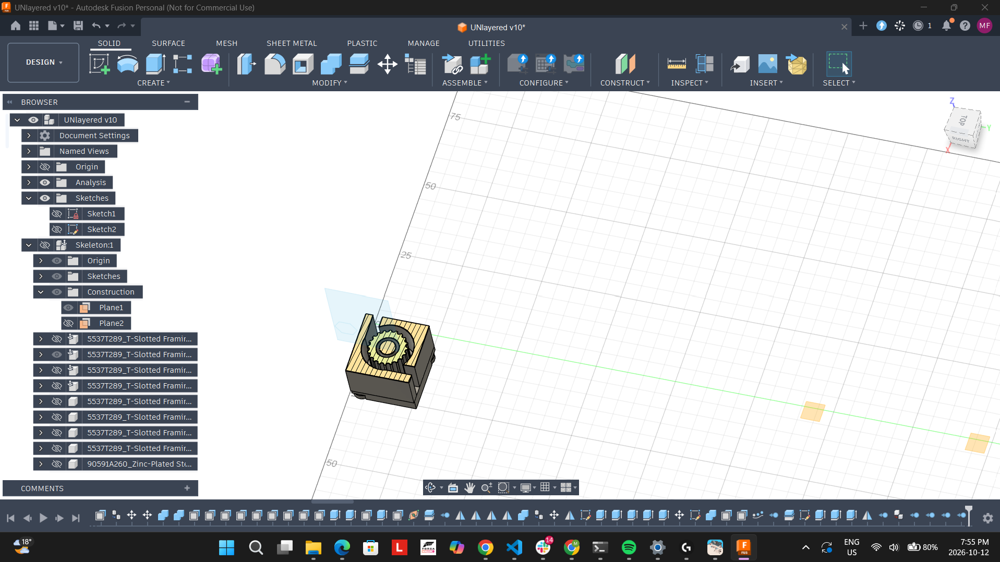

 Shows the lid for the pulley 
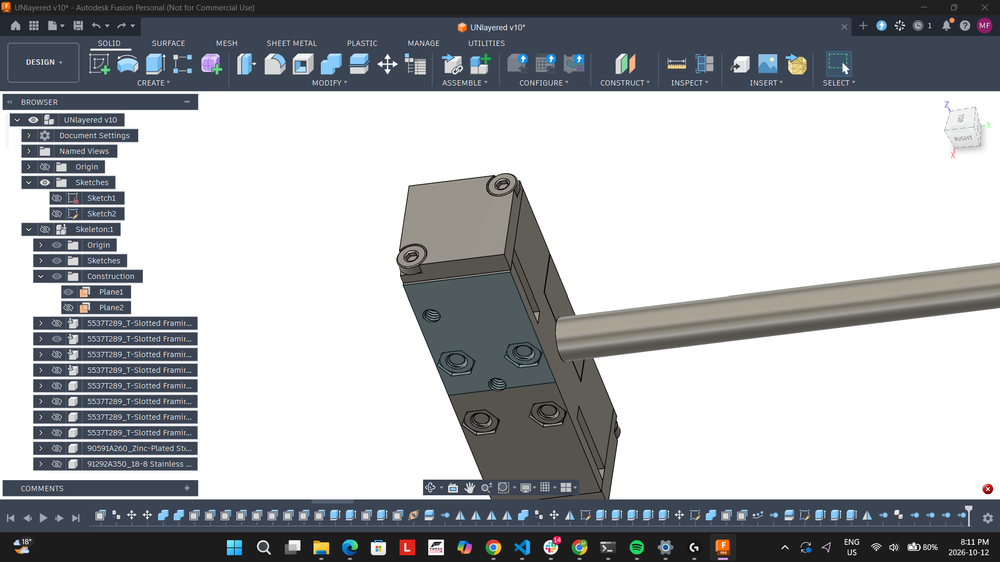

# October 13: Tried to attach a stepper motor to the driver pulley#

Spent 2 hours today working on getting the the motor to driver the pulley. I put the motor on the side because i expected it to be driven by a belt but realized the lack of space. To add the belt to driver the pulley to pulley, only at the end did I realize this thou :(. Yah so forgorre that I could add a senced pulley under or abover the driver pulley to move it.

**Total time spent: 2 hours**
 Both connectors and the rod 

# October 14 - 15: Attached a stepper motor to the driver pulley #

Spent 3 hours today working on getting the stepper motor to directly turne the pulley worked. Used some screws to connect the connector to the main arm connecotrs.

**Total time spent: 3 hours**
 Both connectors and the rod 

# October 16: Created a component to holder the driver pulley and test with ways to hold the other side #

Spent 1 hours today working on adding screws for the pulley comment mount used four to connect it to the corner conector. Right just under where the stepper motor is so you will have to take the stepper off first. Tried experimenting with ways to add the other mounnt to the metal skeleton. Coulddn't firgure out a good idea yet thou.

**Total time spent: 1 hours**
 Both connectors and the rod 
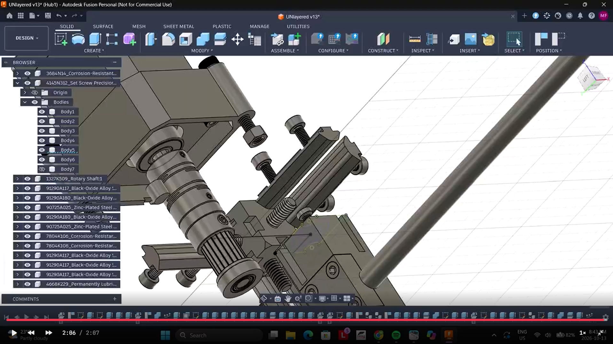

# October 17: Created a mount for the other side of the idle pulley to slide onto the extusion #

Spent 1.5 hours today working on getting the Mount to fit on the extrusion. Had some issues with wondering how to connect it, just used a nut and m3.5 screws to clamp it to the extrusions. The nut is held up with a 3d printed guide.

**Total time spent: 1.5 hours**

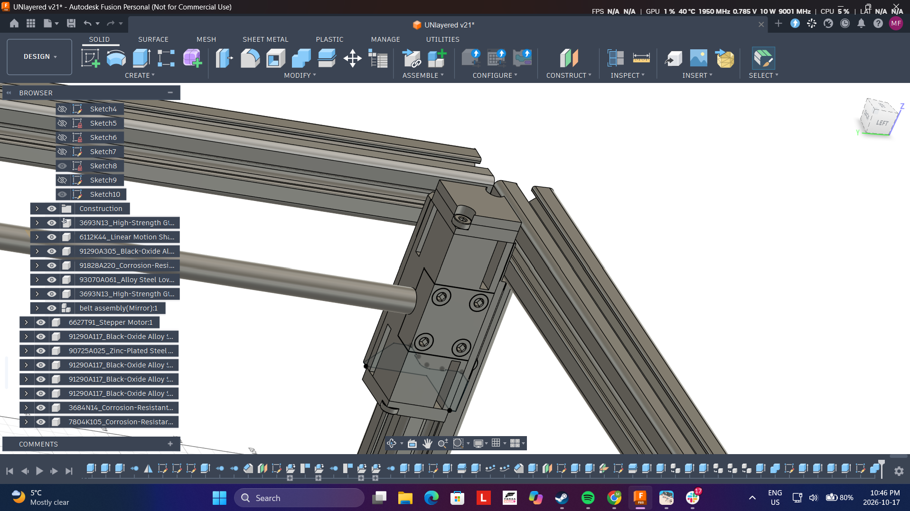

# October 21: Created a mount for the guide rod bearings #

Spent 34 mins today working on mounting the bearing to the guide rod. Also tried find a aliumium extrusion that would fit a rail holder couldn't find one. Thinking about just make the whole thign 3d printed so the rail just sits on a 3d printed parts, just don't know hwo I want to make it look.
 Both connectors and the rod. Sorry if some of theses entries are not detailed enough starting to get the hang of git hub, and the habits of good images.

**Total time spent: 34 mins**

# October 27: Added holes to and split the x rail mount so it can clamp on the bearing #

Spent 1.5 today working on Keeping the bearing for the y axis to clamp onto the x rail mount. Went with two screws for now on eahc side will propable add more just for scrength. The m3.5 scres clamp onto nuts locking the bearing with force and ininer circle slots. Did also add some constraints between the x rails and y rail. With some joints also :). Bad news found out that I somehow didn't allign the pulley from the driver and idle on the oppside so now I have to find a stepper motor with a bigger shaft most likely gonna go up from 19 cm to 24cm shaft. Ugggggaaaa so many promeblms!!!!!! Love how thr mount end, ended loooking up thouuuuuu.

**Total time spent: 1.5 hours**

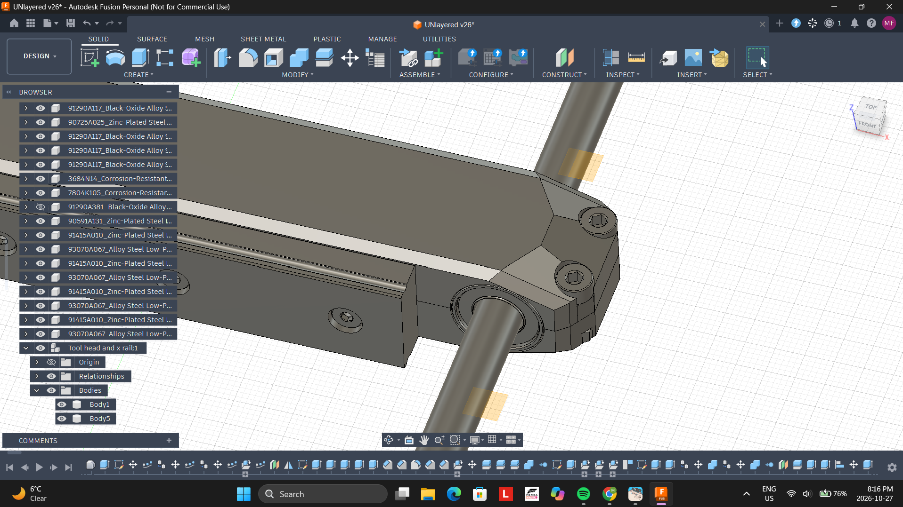

# October 28: Fixed the non-aligned pulleys and started designing a pulley mount on the x axis #

Spent 1.6 today on fixing the mis aligned pulleys and thinking of a good mount design. So the pulley promeblem very easy to to fix just moved the idle pulleys up 5.54 mm to alig. Thou the idle pulley mount for the x axus gave me a hard tim!!! Cause i was thinking How to make it look good not very practically. Them I ended up with this design porb gonna change it so the toolhead has more room to move, Like the ones on the p2s where the pulley mount is cut right where the pulley ends. Also this pulley is tootless and would be touching the back of the belt.

**Total time spent: 1.6 hours**

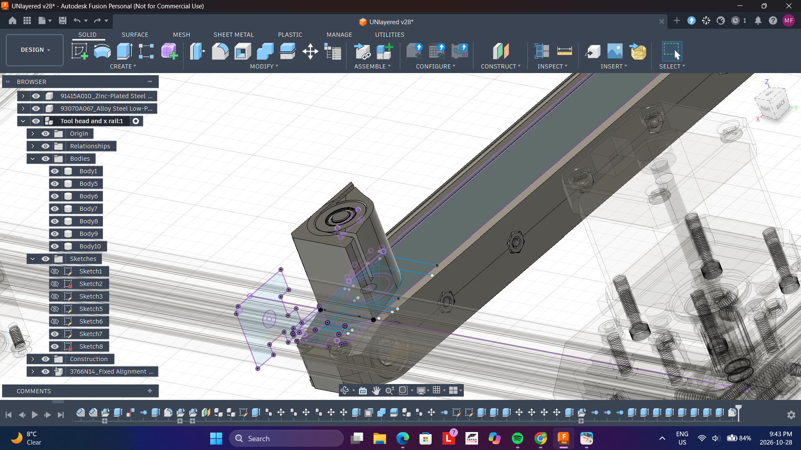

# October 30: Akost finish x axis pulley mount. #

Spent 2.5 today on MAking the x axis mount. Gonna try to make it slide on the the rail mount then hopefully sccrew into the rail after wrd. Nothing to big happend today smooth sailing.

**Total time spent: 2.5 hours**

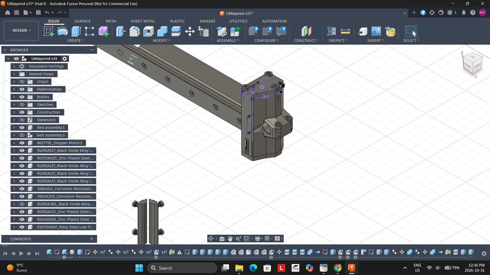

# November 1: Playing around with how to attach the x axis pulley mount to the rail mount #

Spent 45 minutes today playing around with ways to add the pulley mount to the x axis rail mount. Kept running into problems with the small parts, screws weren't good enough dimensions. And I had to make it clamp perfectly making sure it can wiggle.

**Total time spent: 45 mins**

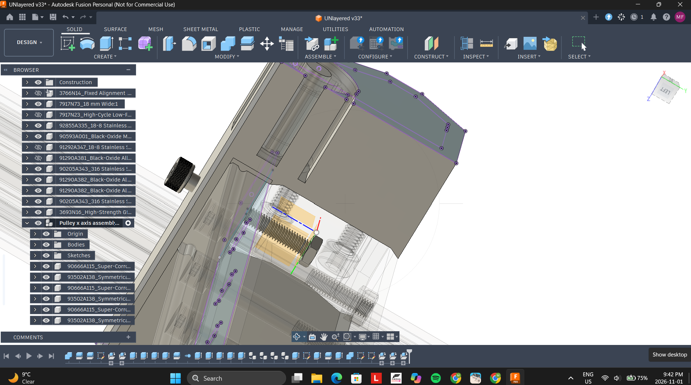

# November 2: Getting two nuts and screws to clamp oppositely to hold the pulley mount.  #

Spent 1 hour today with implementing the idea i thought of at school to use two opisitee screws from either end. Each would clamp onto each other and would stop the pulley mounts from sliding or wiggling around on the mount. Ran into a few prombelms with getting them two close to the bearings and had to hide them under the pulley so in order to tighten them you have to take the pulley out kind of incovenit, I know but it works!!

**Total time spent: 1 hour**

# November 3: Almost done the gantry!!!!! Just got to add the timing belts and the other stepper motor:) .  #

Spent 3 hours today working on add the panel to hold the pulley on the other side, umm also duplicate the whole rigth side so now it looks complete. Still have to add joints and constrains thou. Had a lot of timline promebelms when ever i tried to change something in the past, which really delayed the making of this. Finally go it workign thou, also organized a little more removing the floating bodies and putting them in dedicated components.

**Total time spent: 3 hours**

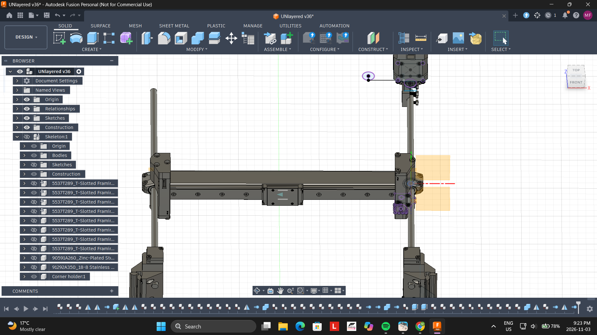

# November 4: Organized some of the components and found problems in my design.  #

Spent 1 hours today working on taking a break from cading and started to organize the componets and their bodies. Which really helped me look over the design and brought some prombelms into perspective. That I will be working on next session. Like how the other pulley mounts pulley isn't aligned correct so now I haev to fix that as well as some nut holes I forgot to add and missing screws I forgot to duplicate. I think this approach really help me review the project as a whole and will most likely be doing it again. I am also thinking about updating the bom list just so I don't get overwhelmed at the end.

**Total time spent: 1 hour**

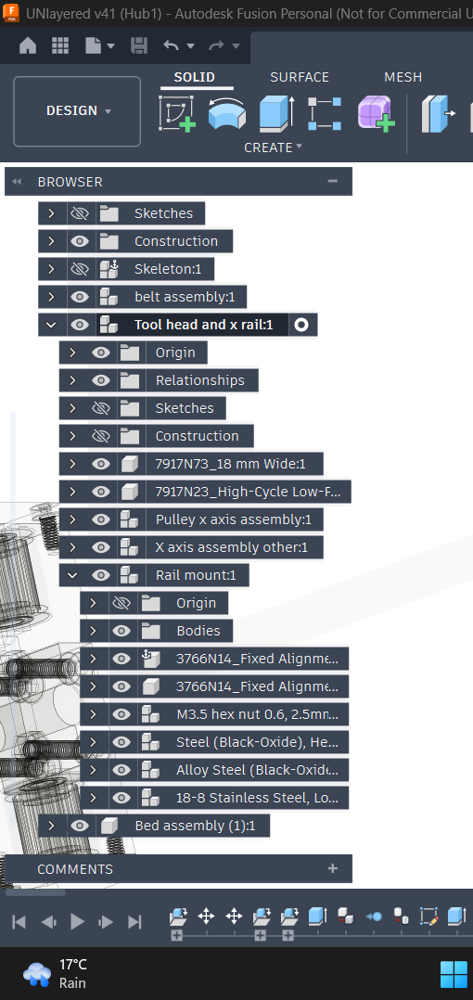

# November 9: Found a two big promeblms uhhhhhhh.  #

So Just realized two major issues first not to bad but the pulley is off by a little bit becuase i didn't know how thick the belt is so prob gonna fix that next, otheerrrrr very big prombelm uhh, I kind of running out of ram. So the design in fusion when I run it takes like 8 gb of ram and I run it on my laptop with 16 gb so windows plus fusion equals my 16 gb limit. Now the computer has resorted to using the ssd as part time ram making it a lottt slower. I was thinking about fixing it but how. The ramm prices right now are like 500 dollars for another 16 gb sodimm. Still thinking of how to resolt this prombelms still. Uhhhhh Sorry I forgot to take a screenshot of the missaligned pulleys

**Total time spent: 1 hour**

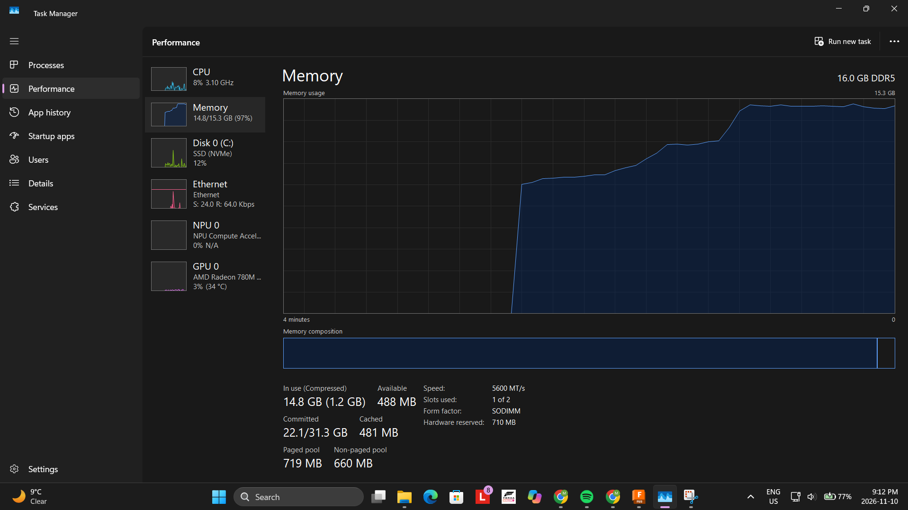

# November 10: Started aligning the x rail pulley.  #

Today to account for the 0.83 mm that I forgot to add inbetween the pulleys I started alturing the timline, short story short did not go very welll :(. The timline is very wonky. I think I got it to work though I just have to check that  everythings is working there seem to be a few promebelm that came from altering the timline so I am planning on doing it tommorow. If you look closely you can see that the attachemnt pulley mount now doesn't alligned pefreclty with the edge on the end of the rail mount anymore.
**Total time spent: 1 hour**

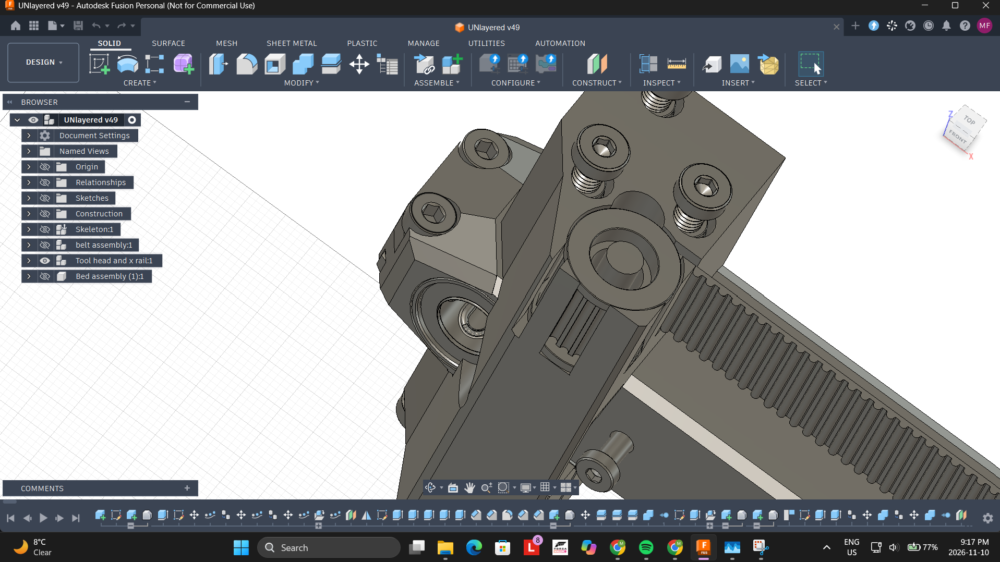

# November 11: Finished aligning the x rail pulley.  #

Spent 3 hours today working on aligning the very annoying pulleys. I hope I am finally done, I also decided to add aa pulley belt(Doesn't have individual grooves), just built it to help visually see where the belt would be and how it would kind of look like. Also add new appearances to parts, never actually used this feature before very new to me. Just help me see what is plastic and what is gonna be bought and is metal, also looks cleaner. The ram is still much a issue and I am still scared for the future. I had colour then forgot to save and add a screenshot went back and now it's gone ;(, if you look in the lapse you can see it though. Right now I also have a problem about how the motor is gonna fit and turn the pulley on the other side. Right now it is intruding  on the aluminum extrusions.
**Total time spent: 3 hours**

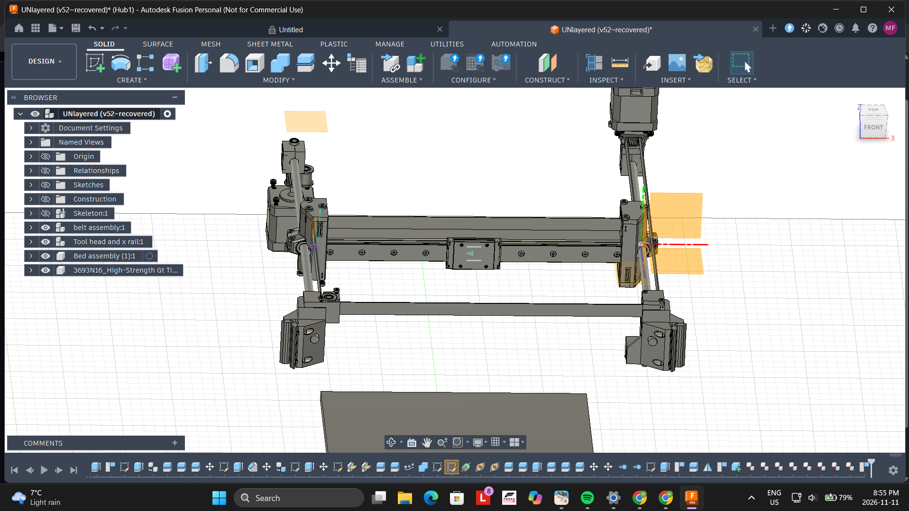

# November 12: Started the other stepper motor mount.  #

Spent 1 hour today working on attaching the stepper motor to the mount and think about the placement, of the pulley. Though this got me thinking about what steppers I am going to buy, because I need cheaper pnes then the MC Master step file place holders I am using right now just as a reference. I though a lot after the lapse and am still now at 10:00 still think about where to buy them. I hear that the voron two motors are nice and fast. Though the cost like 30 bucks each. So hear is the plan, I hope I will buy two of them for the x and y because I need a motor that is fast and has a 24mm shaft. Then I kind of also inspired about how the vorons two build plate design with 3 lead screws, I actually do have 3 stepper motors to use for that, three becuase it helps with auto bed leveling. Thought I could use them for the x and y becuase there shaft is to short and they are kind of slow, so wouldn't  matter too much if I add the with the lead screw.Ummmmm One more thing I have 4 of those tiny motor so I think the last one will go with the extruder. They have the normal nem 17 shape and stuff thou they are kind of the half the hight.
**Total time spent: 1 hour**

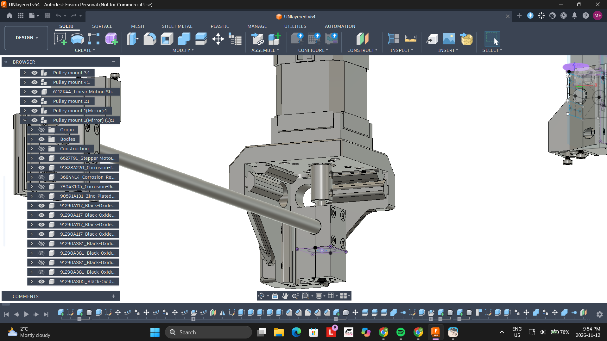.

